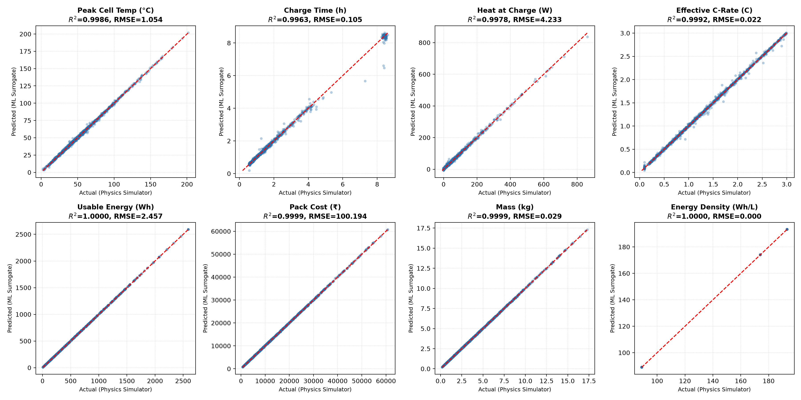

# Battery Pack ML Surrogate Model Evaluation Report

- **Trained On**: 2026-10-21 12:56:23
- **Total Dataset Samples**: 55,000
- **Train/Val/Test Split**: 80% / 10% / 10% (44,000 / 5,500 / 5,500)

## 1. Regression Targets Evaluation (Test Set)

| Target | MAE | RMSE | $R^2$ Score | Residual Std (±1σ) |
| :--- | :--- | :--- | :--- | :--- |
| **Peak Cell Temp (°C)** | 0.7397 | 1.0545 | **0.9986** | ±1.0544 |
| **Charge Time (h)** | 0.0417 | 0.1054 | **0.9963** | ±0.1050 |
| **Heat at Charge (W)** | 2.8804 | 4.2328 | **0.9978** | ±4.2312 |
| **Effective C-Rate (C)** | 0.0123 | 0.0224 | **0.9992** | ±0.0223 |
| **Usable Energy (Wh)** | 1.8800 | 2.4570 | **1.0000** | ±2.4568 |
| **Pack Cost (₹)** | 77.6339 | 100.1936 | **0.9999** | ±100.1693 |
| **Mass (kg)** | 0.0214 | 0.0285 | **0.9999** | ±0.0285 |
| **Energy Density (Wh/L)** | 0.0002 | 0.0002 | **1.0000** | ±0.0002 |

## 2. Model Comparison: Gradient Boosting vs MLP (Validation Set)

| Target | GBR RMSE | GBR $R^2$ | MLP RMSE | MLP $R^2$ | Best Selected |
| :--- | :--- | :--- | :--- | :--- | :--- |
| peak_cell_temp_c | 2.1871 | 0.9937 | 1.0501 | 0.9986 | **MLP** |
| charge_time_h | 0.2226 | 0.9839 | 0.1116 | 0.9959 | **MLP** |
| heat_at_charge_w | 6.6061 | 0.9942 | 4.2449 | 0.9976 | **MLP** |
| effective_charge_rate_c | 0.0584 | 0.9943 | 0.0231 | 0.9991 | **MLP** |
| usable_energy_wh | 2.4548 | 1.0000 | 4.7080 | 0.9999 | **HistGradientBoosting** |
| pack_cost_inr | 99.5565 | 0.9999 | 2119.2986 | 0.9696 | **HistGradientBoosting** |
| mass_kg | 0.0285 | 0.9999 | 0.0500 | 0.9998 | **HistGradientBoosting** |
| energy_density_wh_per_l | 0.0002 | 1.0000 | 0.3173 | 1.0000 | **HistGradientBoosting** |

## 3. Classification Evaluation (Meets All Requirements)

| Metric | Score |
| :--- | :--- |
| **Accuracy** | 0.9867 (98.67%) |
| **Precision** | 0.7778 (77.78%) |
| **Recall** | 0.6316 (63.16%) |
| **F1** | 0.6971 (69.71%) |

## 4. Constraint Classifiers (Test Set)

| Constraint | Accuracy | F1 Score |
| :--- | :--- | :--- |
| fail_temperature | 95.27% | 0.9539 |
| fail_charge_time | 98.62% | 0.9726 |
| fail_cost | 98.98% | 0.9911 |
| fail_energy | 99.38% | 0.9898 |
| fail_charge_rate | 99.09% | 0.9926 |

## 5. Predicted vs Actual Visual Plot

